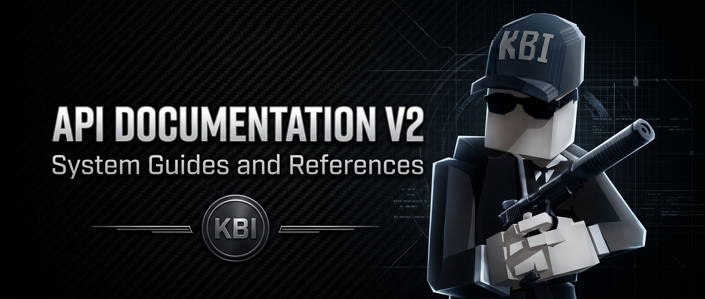

<p align="center">
  
</p>

<h1 align="center">Kour Report API V2</h1>

<p align="center">
  <strong>Integration guide for reports and two-way KBI messaging.</strong>
</p>

This guide covers the V2 endpoints used by Kour Report. Requests use JSON where a body is required. Check both the HTTP status and the response `code`; the `message` field provides readable status information. Browser integrations should use `credentials: "include"`.

## Endpoints

| Method | URL | Purpose |
| --- | --- | --- |
| `POST` | `https://kour-report-api.kourkbi.workers.dev/api/v2/report/token` | Obtain the stable V2 client token. |
| `POST` | `https://kour-report-api.kourkbi.workers.dev/api/v2/report` | Submit a production report. |
| `POST` | `https://kour-report-api.kourkbi.workers.dev/api/v2/report/test` | Submit a test report. |
| `GET` | `https://kour-report-api.kourkbi.workers.dev/api/v2/report/messages` | Retrieve queued KBI messages. |
| `POST` | `https://kour-report-api.kourkbi.workers.dev/api/v2/report/messages` | Send a message to KBI. |
| `POST` | `https://kour-report-api.kourkbi.workers.dev/api/v2/report/messages/read` | Record message read receipts. |
| `GET` | `https://kour-report-api.kourkbi.workers.dev/api/v2/health` | Check API and database availability. |

## Required client token

Get the server-generated token once and save it in the client’s private storage. Reuse it for reports and all Messages API requests. Do not generate a replacement on each request. Browser calls must include `credentials: "include"`.

```js
const response = await fetch(
  "https://kour-report-api.kourkbi.workers.dev/api/v2/report/token",
  { method: "POST", cache: "no-store", credentials: "include" },
);
const result = await response.json();

if (!response.ok || result.success !== true ||
    result.code !== "KOUR_REPORT_API_TOKEN_GENERATED" ||
    typeof result.clientToken !== "string") {
  throw new Error(result.message || `HTTP ${response.status}`);
}

const clientToken = result.clientToken;
```

Send the token as `clientToken` in report request bodies. For message polling, sending, and read receipts, send it in the `X-Client-Token` header.

## Submit a report

Production and test report endpoints accept the same fields. `target`, `roomId`, and `sessionLink` are required; the remaining report fields are optional.

| Field | Type | Requirement |
| --- | --- | --- |
| `target` | string | Required; 1–1000 characters after trimming. |
| `roomId` | string | Required; up to 1000 characters and must match the room ID in `sessionLink`. |
| `sessionLink` | string | Required Kour.io room URL; up to 1000 characters. |
| `reporter` | string | Optional; up to 1000 characters. |
| `reason` | string | Optional; up to 300 characters. |
| `reportScriptVersion` | string | Optional; up to 100 characters after trimming. |
| `roomPlayerCount` | integer | Optional non-negative safe integer; `0` is valid. |
| `clientToken` | string | Required for V2; 1–100 characters. Obtain it from the token endpoint. |
| `turnstileToken` | string | Required only when the server's CAPTCHA policy requests verification; maximum 2048 characters. |

`roomId` must match the fragment after `#` in `sessionLink`. V2 Turnstile verification is conditional: submit first without a token. If the response is HTTP `428` with code `KOUR_REPORT_API_CAPTCHA_REQUIRED` and `captcha.provider` is `"turnstile"`, complete the challenge and retry the same report with a fresh `turnstileToken`.

```js
const response = await fetch(
  "https://kour-report-api.kourkbi.workers.dev/api/v2/report",
  {
    method: "POST",
    credentials: "include",
    headers: {
      "Content-Type": "application/json",
      "X-Client-Token": clientToken,
    },
    body: JSON.stringify({
      target: "ReportedPlayer",
      roomId: "AB12CD",
      sessionLink: "https://kour.io/#AB12CD",
      reporter: "ReportingPlayer",
      reason: "Brief description",
      reportScriptVersion: "2.0.0",
      roomPlayerCount: 6,
      clientToken,
    }),
  },
);
const result = await response.json();
```

Accepted reports return HTTP `201` with `success: true`, code `KOUR_REPORT_API_REPORT_SUBMITTED`, and a `reportId`. Production reports are saved before asynchronous delivery is attempted. Test submissions go to the configured test destination and do not create production report-history entries.

## Messages

### Retrieve messages

Poll `GET /api/v2/report/messages` when the client starts and while its inbox is active. The request has no body and does not require Turnstile. It returns queued messages in queue order; successfully returned messages are not returned again. A successful response always includes a `messages` array, which may be empty.

```js
const response = await fetch(
  "https://kour-report-api.kourkbi.workers.dev/api/v2/report/messages",
  {
    method: "GET",
    cache: "no-store",
    credentials: "include",
    headers: { "X-Client-Token": clientToken },
  },
);
const result = await response.json();

if (response.ok && result.success === true && Array.isArray(result.messages)) {
  for (const item of result.messages) {
    displayMessage(item.message, item.messageId, item.senderName);
  }
}
```

Each message contains its text, a UUID v4 `messageId`, and `senderName`. Older messages without a configured sender name use `"Admin"`.

### Mark messages as read

After displaying messages, send their `messageId` values to the read-receipt endpoint. The request accepts 1–100 message IDs from a successful poll.

```js
const response = await fetch(
  "https://kour-report-api.kourkbi.workers.dev/api/v2/report/messages/read",
  {
    method: "POST",
    credentials: "include",
    headers: {
      "Content-Type": "application/json",
      "X-Client-Token": clientToken,
    },
    body: JSON.stringify({ messageIds: [message.messageId] }),
  },
);
const result = await response.json();
```

The response includes `markedRead`, the number of new read receipts recorded.

### Send a message to KBI

Send a JSON `POST` to `/api/v2/report/messages`. `message` is required (1–2000 characters); `senderName` is optional (up to 100 characters). If the message CAPTCHA policy requests verification, include a fresh `turnstileToken` and retry after completing the challenge.

```js
const response = await fetch(
  "https://kour-report-api.kourkbi.workers.dev/api/v2/report/messages",
  {
    method: "POST",
    credentials: "include",
    headers: {
      "Content-Type": "application/json",
      "X-Client-Token": clientToken,
    },
    body: JSON.stringify({
      message: "I need help with my report.",
      senderName: "Player One",
    }),
  },
);
const result = await response.json();
```

A successful send returns HTTP `201`, code `KOUR_REPORT_API_MESSAGE_SENT`, a `messageId`, `createdAt`, and `senderName`. A blank or omitted `senderName` is returned as `"Unknown"`.

## Health and rate limits

`GET /api/v2/health` returns the API's health status; HTTP `503` indicates an unavailable dependency. Report submissions may return HTTP `429` with a `Retry-After` header when a configured limit applies. Message polling, sending, and read receipts are not subject to the report-submission rate limit.

## Common V2 errors

| Code | HTTP status | Meaning |
| --- | ---: | --- |
| `KOUR_REPORT_API_CLIENT_TOKEN_REQUIRED` | `400` | A V2 report is missing `clientToken`. |
| `KOUR_REPORT_API_CLIENT_TOKEN_CLIENT_MISMATCH` | `403` | The token is not valid for this client. |
| `KOUR_REPORT_API_CAPTCHA_REQUIRED` | `428` | Report verification is required; the response identifies the provider. |
| `KOUR_REPORT_API_INVALID_TURNSTILE_TOKEN` | `400` | The supplied Turnstile token is invalid or too long. |
| `KOUR_REPORT_API_RATE_LIMITED` | `429` | A report-submission limit applies; check `Retry-After`. |
| `KOUR_REPORT_MESSAGES_API_CLIENT_TOKEN_REQUIRED` | `400` | A Messages API request is missing `X-Client-Token`. |
| `KOUR_REPORT_MESSAGES_API_INVALID_MESSAGE` | `400` | The message is empty or longer than 2000 characters. |
| `KOUR_REPORT_MESSAGES_API_INVALID_MESSAGE_IDS` | `400` | Read-receipt IDs are invalid or outside the 1–100 item limit. |
| `KOUR_REPORT_MESSAGES_API_CAPTCHA_REQUIRED` | `428` | Sending a message requires CAPTCHA verification. |
| `KOUR_REPORT_MESSAGES_API_UNAVAILABLE` | `500` | A message operation could not be completed. |

Error responses include a readable `message`. Use the HTTP status and `code` to decide whether to retry, request verification, or report a failure.

---

<p align="center">
  <a href="./README.md">Back to the project README</a>
</p>
