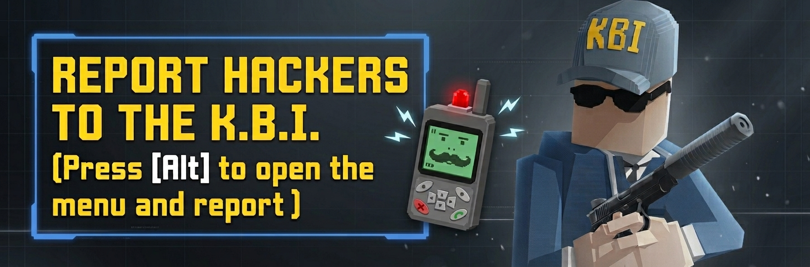
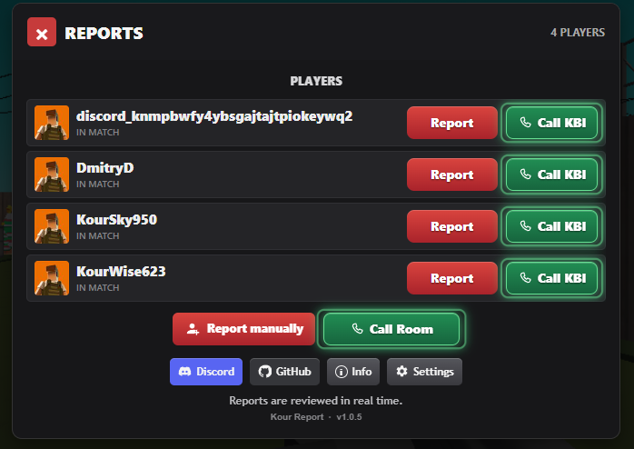
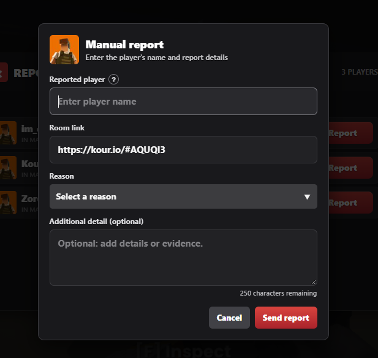
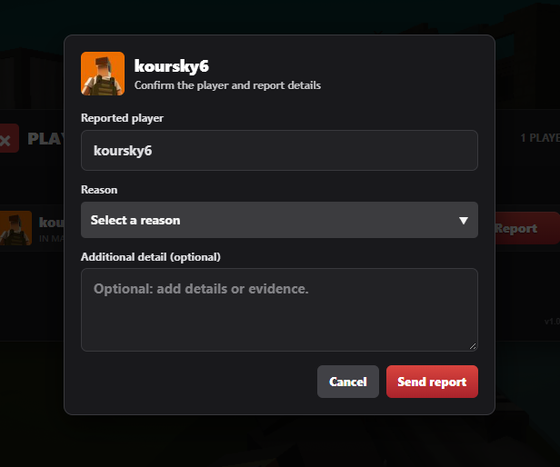
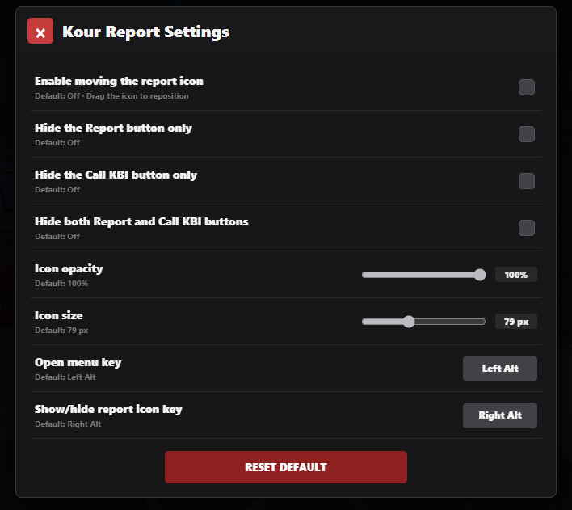
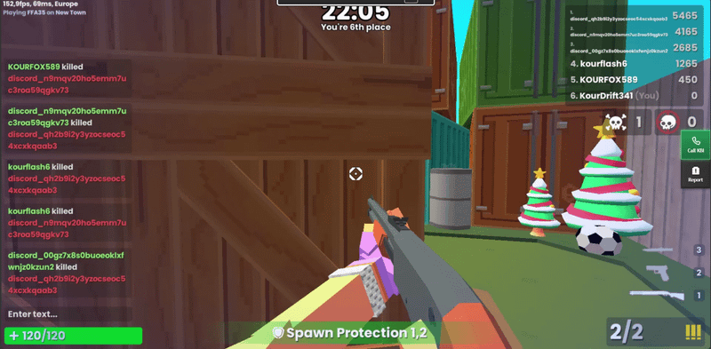
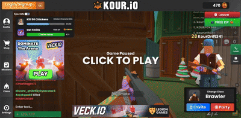
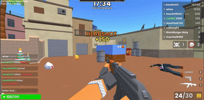
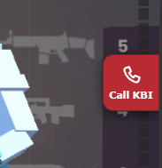
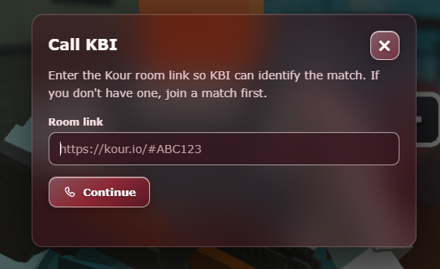

  

<h1 align="center">Kour Report</h1>

  
  

**Kour Report** is a userscript for reporting players in a [Kour.io](https://kour.io/) match. It shows the players currently in your room and lets you submit a report to the KBI team without leaving the game.

> [!IMPORTANT]
> **Kour Report is an independent community project. It is not affiliated with, endorsed by, sponsored by, or officially connected to Kour.io or Legion Platforms, the developer of Kour.io.**

> [!IMPORTANT]
> This script and its endpoint are intended for use on **Kour.io**. The endpoint only works in the Kour.io context. Running the script or an integration from another website, a server, or an external application will not work.

## 📦 Script

The userscript is **[kour-report.js](./kour-report.js)**. Install this file to use the in-game reporting menu.

## 🚀 Installation

1. Install a userscript manager compatible with your browser, such as Tampermonkey or Violentmonkey.
2. **Recommended:** install [Kour Report from Greasy Fork](https://greasyfork.org/scripts/602206-kour-report). Open the page and press **Install**; your userscript manager will guide you through the installation.
3. Alternatively, open [kour-report.js](./kour-report.js) on GitHub, copy its contents, and create a new userscript in your manager. You can also import the file if your manager supports it.
4. Open or reload [Kour.io](https://kour.io/). Select the **Report** button to open the menu. By default, holding **Left Alt** opens a shortcut wheel: move the pointer over **Open KBI Report** and release the key. The other wheel option starts a **Call KBI** request. You can open the menu in the lobby; to submit a manual report there, provide a valid Kour room link.

Greasy Fork and GitHub provide the same version of the script and are kept up to date together. Greasy Fork is the easiest option because your userscript manager handles installation and updates.

In **Settings**, you can change the menu shortcut and the shortcut for showing or hiding both floating buttons. You can independently hide **Report** or **Call KBI**, or hide both together; adjust their shared size (44–140 px) and the **Report** button's opacity (10–100%); and enable dragging to reposition the **Report** button. The **Call KBI** button follows it. Settings are saved for future visits, and **Reset Default** restores the original values.

Kour Report is designed for current versions of Chrome, Edge, Firefox, and Safari with a compatible userscript manager. Older browsers that lack modern JavaScript, Shadow DOM, or Pointer Events (including Internet Explorer) are not supported. The Alt shortcut menu still dims the background if a browser does not support backdrop blur.

> [!NOTE]
> By default, holding **Left Alt** opens a shortcut wheel. Move the pointer over **Open KBI Report** or **Call KBI**, then release **Left Alt** to choose. **Right Alt** shows or hides both floating buttons. Both shortcuts can be changed in Settings.

When a newer version is available, the report icon displays an update badge and the game shows a notification. Open the menu and select **Update** to choose Greasy Fork (recommended) or GitHub.

The menu footer also links to the KBI Discord and project GitHub, opens the **Info** panel, and displays the installed script version.

## 🖼️ Screenshots

### Report Menu

### Report Manually

### Report Details Menu

### Report Settings Menu

### KBI Call

The **Report** launcher has a companion **Call KBI** button that appears when you hover over or keyboard-focus the launcher. The main menu also has room and per-player **Call KBI** options. A player call identifies that player for KBI; a room call requests help for the current room. Both call flows require the Cloudflare Turnstile check:

**Call KBI for a selected player** sends a call to KBI identifying the selected player so the team can attend to them:

**Call KBI for the current room** sends a call to KBI about the room you are currently in. If players are detected, the menu first lets you choose a player or continue with a room call. If the menu cannot detect a room link, it asks you to enter one; the floating quick-call button and shortcut-wheel call option require an active room:

## ✨ New: Call KBI Light

**Call KBI Light** is a lightweight companion userscript for sending a room-level call directly to the KBI team from Kour.io. It is separate from the full Kour Report script: it does not detect or select a player, and it does not replace player reports.

### Features

- Adds a floating **Call KBI** telephone button on Kour.io, plus an **Alt** keyboard shortcut to open or close its menu.
- Uses a compact, translucent dialog isolated from the game's page styles.
- Detects the current room from the Kour.io URL and fills in its link automatically. You can also enter or edit a room link yourself.
- Validates that the link is an HTTP(S) Kour.io link with a room ID before continuing.
- Loads Cloudflare Turnstile verification only when you submit a request. The request is sent after verification succeeds.
- Sends a room-level call to KBI; it does not identify a selected player.
- Shows progress, success, and error messages in the menu.
- Lets you close the menu with its close button, by clicking outside the dialog, or with **Escape**.

### How to send a call

1. Open a Kour.io match, then select **Call KBI** or press **Alt**. The current room link is filled in automatically when available.
2. Confirm or edit the room link. If you are in the lobby, enter a Kour.io room link that includes its room ID.
3. Select **Continue** and complete Cloudflare Turnstile verification.
4. After verification, the script sends the room call to KBI and displays the result.

The request includes the room ID and link, identifies the call as a room-level request (no player selected), and includes your saved in-game nickname when available. If the match changes while verification is in progress, verify the updated room link before continuing.

Install it with Tampermonkey or another compatible userscript manager:

- **[Install Call KBI Light from Greasy Fork](https://greasyfork.org/en/scripts/603514-call-kbi-light)**
- **[Open the reusable prompt](./call-kbi-light/call-kbi-light-menu.prompt.md)** — describes the menu design and implementation so you can ask an AI coding assistant to create your own compatible version or adapt it.

### Call KBI Light screenshots

**In-game button**

**Menu**

## ⚙️ How It Works

1. When run on Kour.io, the script detects the current match and lists other players in the room. The **Players** heading and player count appear only when there are players to report.
2. Select a detected player or choose **Report manually** to enter a name yourself. Manual reporting is available in the lobby and at any time; when no players are detected, the button appears with the empty-state message, and when players are listed it appears below them. Choose a reason: **Invisibility**, **Aimbot**, **Flying**, **Wallhack**, or **Other**. If detection returns no players in a match, the menu notes that the room may be empty or detection may have failed.
3. Optionally add details to the report.
4. Complete the Cloudflare Turnstile security check to submit the report. The result is shown in the report menu.

For an automatic report, the selected player must still be in the current match. Choose **Report manually** at any time to enter the player's name yourself. If you do not know the full name or it is difficult to spell, use the **?** beside the name field for help; you can leave the field blank or enter only the part you know.

The room link is filled in automatically when a room ID is detected. In the lobby, or if no room link is detected, enter a Kour.io room link that includes its room ID before submitting. You can edit the link in the report form.

> [!WARNING]
> Submit only legitimate reports. Do not repeatedly report players to harass them, submit false information, or attempt to bypass Turnstile or the service's controls.

> [!CAUTION]
> The reporting service is operated by KBI. Its availability and behavior may change without notice.

## 💬 Discord

Join the KBI Discord to discuss the project and reports:

## 📄 License

The userscript metadata in [kour-report.js](./kour-report.js) declares the **MIT License**.
