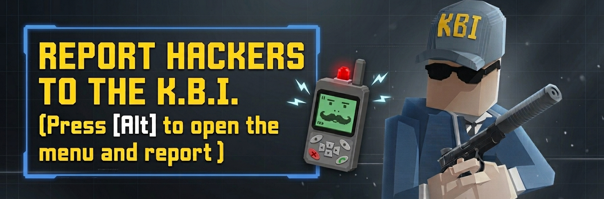
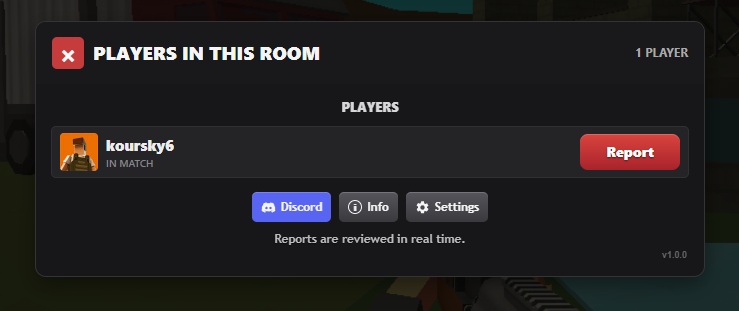
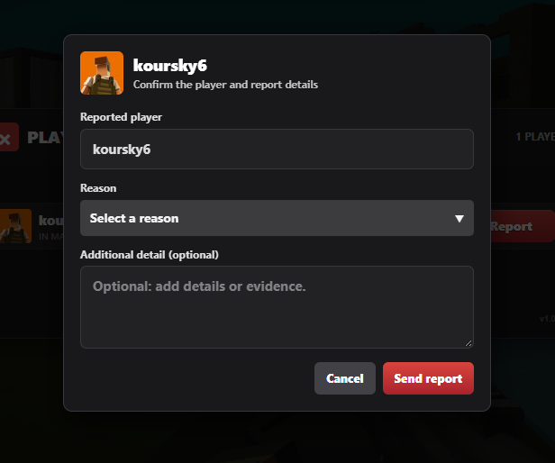
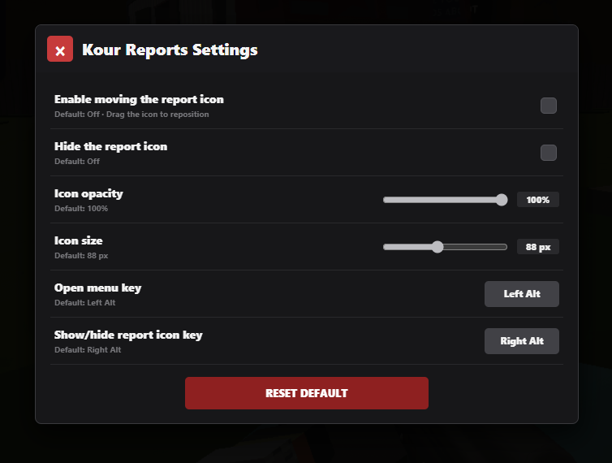

<p align="center">
  
</p>

<h1 align="center">Kour Report</h1>

<p align="center">
  <a href="https://discord.gg/R9wuHc6ucg">
    
  </a>
  <a href="./LICENSE.md">
    
  </a>
</p>

**Kour Report** is a userscript for reporting players from a [Kour.io](https://kour.io/) match. It displays the players in your current room and lets you submit a report to the KBI team without leaving the game.

> [!IMPORTANT]
> **Kour Report is an independent community project. It is not affiliated with, endorsed by, sponsored by, or officially connected to Kour.io or Legion Platforms, the developer of Kour.io.**

> [!IMPORTANT]
> This script and its endpoint are intended for use on **Kour.io**. The endpoint only works in the Kour.io context. Running the script or an integration from another website, a server, or an external application will not work.

## 📦 Script

The main file is **[kourkbi-report.js](./kourkbi-report.js)**. Install this userscript; the banner above is just a project image.

## 🚀 Installation

1. Install a userscript manager compatible with your browser, such as Tampermonkey or Violentmonkey.
2. Open [kourkbi-report.js](./kourkbi-report.js), copy its contents, and create a new userscript in your manager. You can also import the file if your manager supports it.
3. Save the script and open or reload [Kour.io](https://kour.io/).
4. Join a match and press **Left Alt** to open the report menu.

You can also open the menu with the script icon. In **Settings**, you can change the menu shortcut, the shortcut for showing or hiding the icon, and the icon's size, opacity, and position. These settings are saved in your browser's local storage.

> [!NOTE]
> The default menu shortcut is **Left Alt**, and the default shortcut for showing or hiding the icon is **Right Alt**. You can change both in settings.

## 🖼️ Screenshots

### Report Menu



### Report Details Menu



### Report Settings Menu



## ⚙️ How It Works

1. When run on Kour.io, the script detects the match and lists the other players in the room.
2. Select a player, choose a reason, and optionally add details.
3. Complete the Cloudflare Turnstile security check before submitting the report.
4. The script sends the report to the KBI endpoint and displays the result in-game.

The form requires the reported player to still be in the match, and your player name and room ID must be available. Additional details are optional and limited to 500 characters. After an accepted report, the script applies a local 60-second cooldown for that player.

When you submit a report, the following information is sent: the reporter's name, the reported player's name, the reason and any additional details, the room ID, the session link, and the Turnstile token. This information is used to process and review the report.

## 🔌 Using the Endpoint in Another Project

This script uses the following reporting endpoint:

```text
https://kour-report-api.kourkbi.workers.dev/api/report
```

You can integrate it into another userscript or project **running inside a Kour.io page** by sending a JSON `POST` request. For example:

The userscript can be modified to build a custom reporting menu. For endpoint documentation, including rate limits and other API details, visit the dedicated API channel in the [KBI Discord](https://discord.gg/R9wuHc6ucg).

```js
async function submitReport(validTurnstileToken) {
  const response = await fetch(
    "https://kour-report-api.kourkbi.workers.dev/api/report",
    {
      method: "POST",
      credentials: "include",
      headers: { "Content-Type": "application/json" },
      body: JSON.stringify({
        reporter: "Your Kour.io name",
        target: "Reported player",
        reason: "Selected reason; optional details",
        roomId: window.location.hash.slice(1).trim(),
        sessionLink: window.location.href,
        turnstileToken: validTurnstileToken,
      }),
    }
  );

  const result = await response.text();
  if (!response.ok) {
    throw new Error(`The endpoint rejected the report (HTTP ${response.status}): ${result}`);
  }
  return result;
}
```

`validTurnstileToken` must be a valid token obtained through the security check required by the service. The reporter, player, reason, room ID, and session link must correspond to a real match and report. The server may reject incomplete requests or requests that fail its validation. An HTTP success response alone does not necessarily mean the report was accepted.

> [!WARNING]
> Use the endpoint only for legitimate, occasional reports. Do not automate submissions, repeatedly report players to harass them, submit false information, or attempt to bypass Turnstile or the service's controls. Abuse can harm other players and cause the endpoint to become unavailable.

> [!CAUTION]
> The endpoint is controlled by KBI. Its availability, ongoing compatibility, and support for external integrations are not guaranteed; its behavior may change without notice.

## 💬 Discord

Join the KBI Discord to discuss the project and reports:

[](https://discord.gg/R9wuHc6ucg)

## 📄 License

This project is distributed under the **Kour Report Community License**, a custom permissive license that allows the script to be used, modified, and redistributed, including in commercial projects, subject to the license terms. These include a prohibition on using the script to spam or abuse the reporting endpoint. Read the full terms in [LICENSE.md](./LICENSE.md).

> [!NOTE]
> This is a custom project license, not an OSI-approved standard license. If you need compatibility with a standard license, consult the project maintainer before redistributing the project under different terms.
