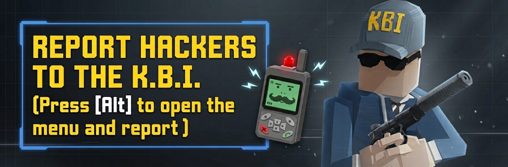
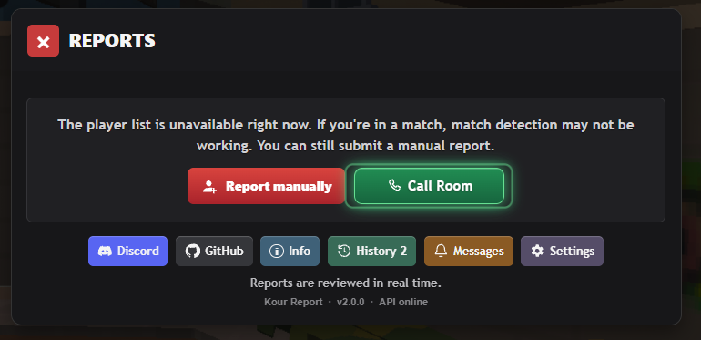
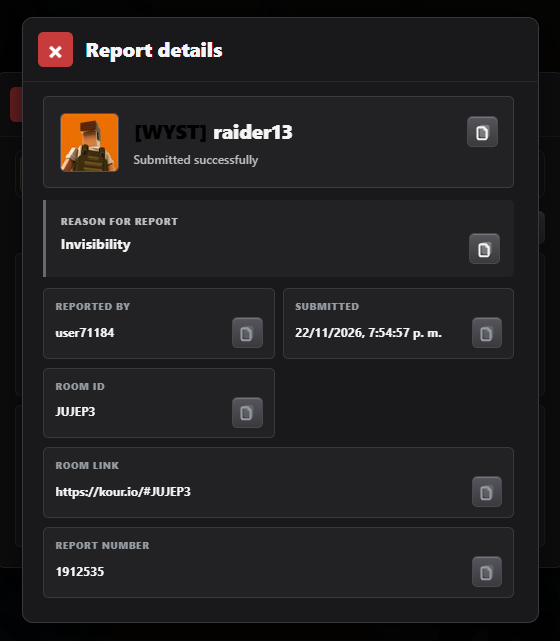
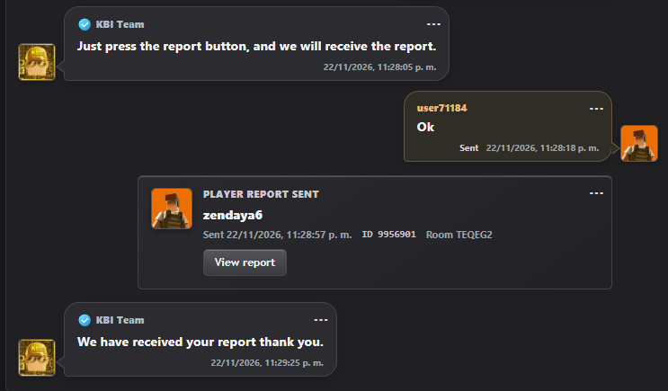
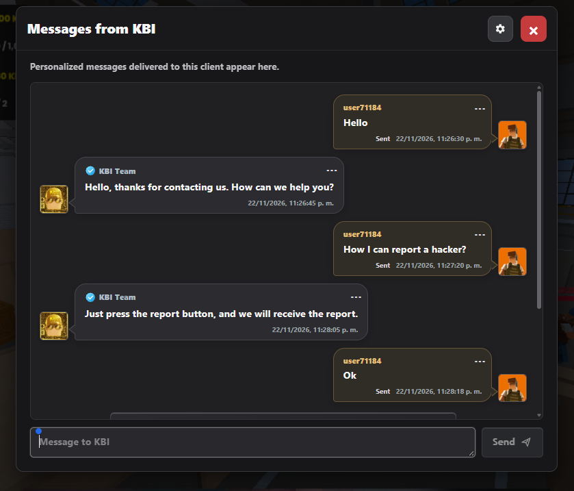
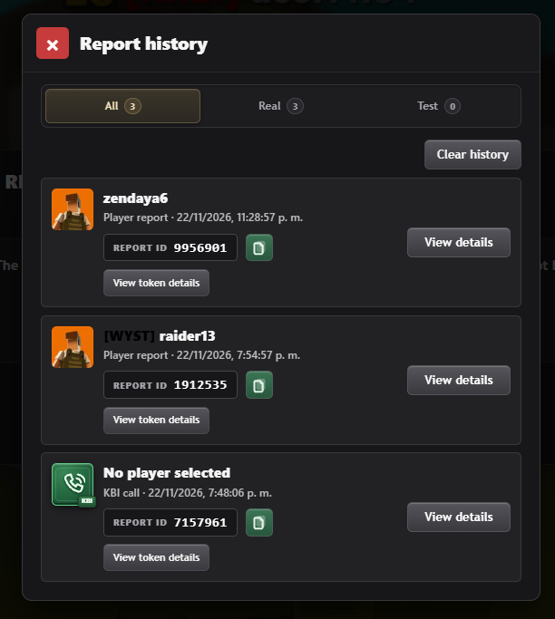
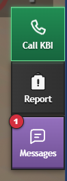
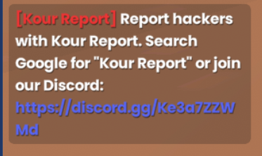
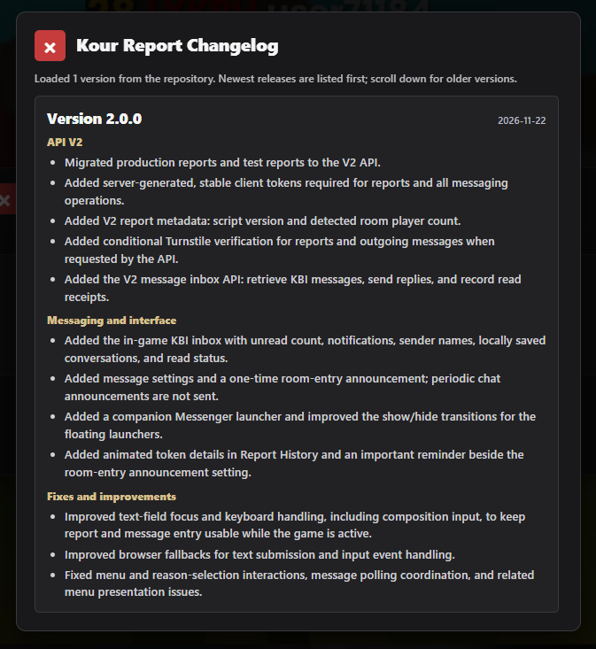

  

<h1 align="center">Kour Report</h1>

  
  

**Kour Report** is a userscript for reporting players in a [Kour.io](https://kour.io/) match. It shows the players currently in your room and lets you submit a report to the KBI team without leaving the game.

> [!IMPORTANT]
> **Kour Report is an independent community project. It is not affiliated with, endorsed by, sponsored by, or officially connected to Kour.io or Legion Platforms, the developer of Kour.io.**

> [!IMPORTANT]
> This script and its endpoint are intended for use on **Kour.io**. The endpoint only works in the Kour.io context. Running the script or an integration from another website, a server, or an external application will not work.

## 📦 Script

The userscript is **[kour-report.js](./kour-report.js)**. Install this file to use the in-game reporting menu.

## 🔌 API Documentation

Integrating with the report service? See the [Kour Report API documentation](./API-DOCUMENTATION.md) for endpoints, request fields, response codes, and examples.

## 🚀 Installation

1. Install a userscript manager compatible with your browser, such as Tampermonkey or Violentmonkey.
2. **Recommended:** install [Kour Report from Greasy Fork](https://greasyfork.org/scripts/602206-kour-report). Open the page and press **Install**; your userscript manager will guide you through the installation.
3. Alternatively, open [kour-report.js](./kour-report.js) on GitHub, copy its contents, and create a new userscript in your manager. You can also import the file if your manager supports it.
4. Open or reload [Kour.io](https://kour.io/). Select the **Report** button to open the menu. By default, holding **Left Alt** opens a shortcut wheel: move the pointer over **Open KBI Report** and release the key. The other wheel option starts a **Call KBI** request. You can open the menu in the lobby; to submit a manual report there, provide a valid Kour room link.

Greasy Fork and GitHub provide the same version of the script and are kept up to date together. Greasy Fork is the easiest option because your userscript manager handles installation and updates.

In **Settings**, you can change the menu shortcut and the shortcut for showing or hiding both floating buttons. You can independently hide **Report** or **Call KBI**, or hide both together; adjust their shared size (44–140 px) and the **Report** button's opacity (10–100%); enable dragging to reposition the **Report** button; and turn update notifications on or off. You can also choose which screen corner message notifications use and review script errors in the local **Error logs** viewer. The **Call KBI** button follows the **Report** button. Settings are saved for future visits, and **Reset Default** restores the original values.

The **Client token** section in Settings shows the V2 API token masked by default, with controls to reveal or copy it. Kour Report obtains this token from the V2 API and reuses it for reports and messaging. Keep it unchanged so the API can connect reports and inbox replies for this installation.

Kour Report is designed for current versions of Chrome, Edge, Firefox, and Safari with a compatible userscript manager. Older browsers that lack modern JavaScript, Shadow DOM, or Pointer Events (including Internet Explorer) are not supported. The Alt shortcut menu still dims the background if a browser does not support backdrop blur.

> [!NOTE]
> By default, holding **Left Alt** opens a shortcut wheel. Move the pointer over **Open KBI Report** or **Call KBI**, then release **Left Alt** to choose. **Right Alt** shows or hides both floating buttons. Both shortcuts can be changed in Settings.

When a newer version is available, the report icon displays an update badge and the game shows a notification. Turn off **Show update notifications** in Settings to hide the badge, the menu update notice, and the in-game alert. When notifications are enabled, open the menu and select **Update** to choose Greasy Fork (recommended) or GitHub. Select **Changelog** beside the menu version to browse release notes; the script reloads [CHANGELOG.md](./CHANGELOG.md) each time the menu opens.

The menu footer also links to the KBI Discord and project GitHub, opens the **Info** panel, and displays the installed script version.

Select **Messages** in the menu to open the KBI message inbox. While Kour Report is active, it checks the API V2 message queue when the page starts, every 3 seconds, and when the page becomes visible again. New messages show a notification and an unread badge; opening the inbox marks them as read through the V2 read-receipt endpoint. Messages are saved in the browser so they remain available after a reload. Polling is coordinated across active script instances to avoid overlapping checks.

In **Settings > Messages**, you can enable or disable the room-entry chat announcement and send it manually with **Send**. The announcement invites players to report hackers with Kour Report by searching Google for **Kour Report** or joining the KBI Discord. The Discord invite is shown in Discord blue. No periodic chat announcements are sent.

## 🖼️ Screenshots

The screenshots below show the main reporting and messaging features, followed by related controls and interface details.

### Main report menu

The menu provides access to manual reporting, room calls, report history, messages, and settings. This example also shows the empty player-list state, where manual reports and room calls remain available.

### Report details

The details panel summarizes a submitted report, including its reason, reporter, room, submission time, and report number.

### Reports in the message history

Report submissions appear in the KBI conversation alongside regular chat messages, with a **View report** action for opening the report details.

### KBI message inbox

The inbox shows incoming replies and sent messages as chat bubbles, with sender identity, timestamps, and message actions.

### Report history

Report history separates real and test submissions and provides report IDs, details, and token-detail controls.

### Floating in-game buttons

The floating controls provide separate shortcuts for **Call KBI**, **Report**, and **Messages**. The Messages button displays an unread-count badge.

### Room-entry announcement

When enabled, the script can post a one-time message on entering a room, inviting players to find Kour Report or join the KBI Discord.

### Changelog

The in-game changelog presents release notes by version, grouping API updates, interface improvements, and fixes.

## ⚙️ How It Works

1. When run on Kour.io, the script detects the current match and lists other players in the room. The **Players** heading and player count appear only when there are players to report.
2. Select a detected player or choose **Report manually** to enter a name yourself. Manual reporting is available in the lobby and at any time; when no players are detected, the button appears with the empty-state message, and when players are listed it appears below them. Choose a reason: **Invisibility**, **Aimbot**, **Flying**, **Wallhack**, or **Other**. If detection returns no players in a match, the menu notes that the room may be empty or detection may have failed.
3. Optionally add details to the report.
4. If the V2 API requests it, complete the Cloudflare Turnstile security check. The result is shown in the report menu.

For an automatic report, the selected player must still be in the current match. Choose **Report manually** at any time to enter the player's name yourself. If you do not know the full name or it is difficult to spell, use the **?** beside the name field for help; you can leave the field blank or enter only the part you know.

The room link is filled in automatically when a room ID is detected. In the lobby, or if no room link is detected, enter a Kour.io room link that includes its room ID before submitting. You can edit the link in the report form.

> [!WARNING]
> Submit only legitimate reports. Do not repeatedly report players to harass them, submit false information, or attempt to bypass Turnstile or the service's controls.

> [!CAUTION]
> The reporting service is operated by KBI. Its availability and behavior may change without notice.

## 💬 Discord

Join the KBI Discord to discuss the project and reports:

## 📄 License

The userscript metadata in [kour-report.js](./kour-report.js) declares the **MIT License**.
