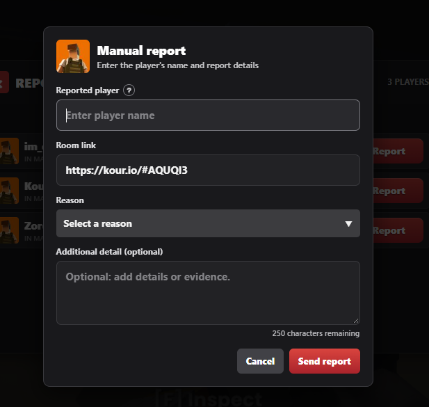

<h1 align="center">Kour Report</h1>

  
  

**Kour Report** is a userscript for reporting players in a [Kour.io](https://kour.io/) match. It shows the players currently in your room and lets you submit a report to the KBI team without leaving the game.

> [!IMPORTANT]
> **Kour Report is an independent community project. It is not affiliated with, endorsed by, sponsored by, or officially connected to Kour.io or Legion Platforms, the developer of Kour.io.**

> [!IMPORTANT]
> This script and its endpoint are intended for use on **Kour.io**. The endpoint only works in the Kour.io context. Running the script or an integration from another website, a server, or an external application will not work.

## 📦 Script

The userscript is **[kour-report.js](./kour-report.js)**. Install this file to use the in-game reporting menu.

## 🚀 Installation

1. Install a userscript manager compatible with your browser, such as Tampermonkey or Violentmonkey.
2. **Recommended:** install [Kour Report from Greasy Fork](https://greasyfork.org/scripts/602206-kour-report). Open the page and press **Install**; your userscript manager will guide you through the installation.
3. Alternatively, open [kour-report.js](./kour-report.js) on GitHub, copy its contents, and create a new userscript in your manager. You can also import the file if your manager supports it.
4. Open or reload [Kour.io](https://kour.io/). Press **Left Alt** to open the report menu, or select the report icon. You can open the menu in the lobby and submit a manual report without joining a match.

Greasy Fork and GitHub provide the same version of the script and are kept up to date together. Greasy Fork is the easiest option because your userscript manager handles installation and updates.

In **Settings**, you can change the menu shortcut and the shortcut for showing or hiding the icon. You can also adjust the icon's size and opacity, hide it, and enable dragging to reposition it.

> [!NOTE]
> The default menu shortcut is **Left Alt**, and the default shortcut for showing or hiding the icon is **Right Alt**. Both shortcuts can be changed in settings.

When a newer version is available, the report icon displays an update badge and the game shows a notification. Open the menu and select **Update** to choose Greasy Fork (recommended) or GitHub.

## 🖼️ Screenshots

### Report Menu

### Report Manually

### Report Details Menu

### Report Settings Menu

## ⚙️ How It Works

1. When run on Kour.io, the script detects the current match and lists other players in the room. The **Players** heading and player count appear only when there are players to report.
2. Select a detected player or choose **Report manually** to enter a name yourself. Manual reporting is available in the lobby and at any time; when no players are detected, the button appears with the empty-state message, and when players are listed it appears below them. Choose a reason: **Invisibility**, **Aimbot**, **Flying**, **Wallhack**, or **Other**. If detection returns no players in a match, the menu notes that the room may be empty or detection may have failed.
3. Optionally add details. The selected reason and additional details together can contain up to 250 characters.
4. Complete the Cloudflare Turnstile security check to submit the report. The result is shown in the report menu.

For an automatic report, the selected player must still be in the current match. Choose **Report manually** at any time to enter the player's name yourself. If you do not know the full name or it is difficult to spell, use the **?** beside the name field for help; you can leave the field blank or enter only the part you know.

The room link is filled in automatically when a room ID is detected. In the lobby, or if no room link is detected, enter a Kour.io room link that includes its room ID before submitting. You can edit the link in the report form.

> [!WARNING]
> Submit only legitimate reports. Do not repeatedly report players to harass them, submit false information, or attempt to bypass Turnstile or the service's controls.

> [!CAUTION]
> The reporting service is operated by KBI. Its availability and behavior may change without notice.

## 💬 Discord

Join the KBI Discord to discuss the project and reports:

## 📄 License

This project is distributed under the **MIT License**, which permits use, modification, distribution, sublicensing, and sale, provided the copyright and permission notice are included with copies or substantial portions of the software. Read the full terms in [LICENSE.md](./LICENSE.md).
